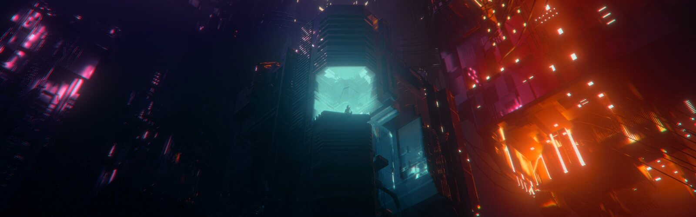

  

# Anmol Dhiman

I build software, automate repetitive work, and figure out why things break.

Software engineer focused on AI, automation, and secure systems. Technical Lead on GACI Online at Humber.

`Python` · `C++` · `TypeScript` · `React` · `Flask` · `SQLite`

### A few things I’ve built

- **[AI Trading Arena](https://github.com/Anmol-STRS/AITraderBotMLProject)** · Stock-prediction experiments with XGBoost, Flask, and React.
- **[Terrain Builder](https://github.com/Anmol-STRS/TerrainBuilderI-0)** · A C++ geospatial pipeline. Public documentation release.
- **[Humber Workbook Insights](https://github.com/Anmol-STRS/Humber-Workbook-Insights)** · Assessment analytics and automated Excel/PDF reports. Showcase of a private system.

[Portfolio](https://anmold.dev) · [LinkedIn](https://linkedin.com/in/anmoldhimann) · [Email](mailto:contact@anmold.dev)
